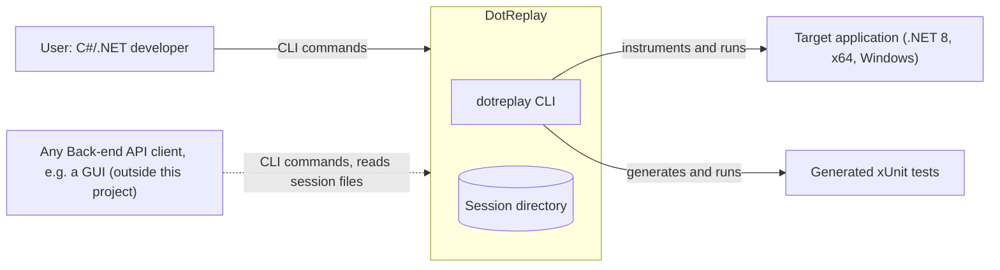
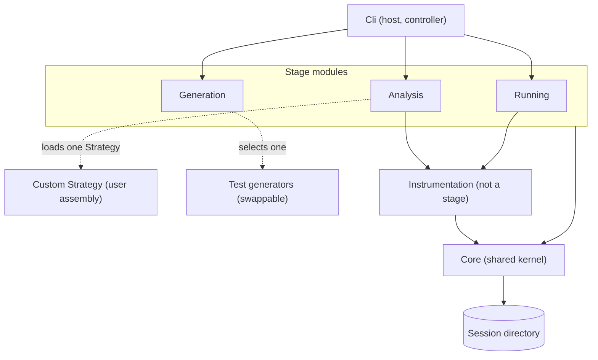

# Architecture

## Overview

DotReplay is a modular monolith: one CLI program built from modules with explicit, tested boundaries. It consists of a Back-end API, a controller, stages, a model and shared modules:

- **Back-end API (public interface).** The `dotreplay` CLI with its commands, options, exit codes and error codes, and the versioned file formats of the Session directory (R9, R26, R28). Users and other programs use DotReplay only through it. Nothing inside DotReplay depends on any particular client. The file formats follow version 1 of the shared [Auto Debugger contract](https://github.com/norilanda/debug-infra-gentests/tree/develop/vs-code-extension/contract): `run.json`, `trace.json`, `tests.json` and `results.json`. DotReplay adds its own `manifest.json`, which the contract allows.
  - `dotreplay [options]`: the full run ([pipeline_run.md](use-cases/pipeline_run.md), R6).
  - `dotreplay analyze [options]`: the analysis stage.
  - `dotreplay generate-tests --run-dir <dir>`: the test generation stage.
  - `dotreplay run-tests --run-dir <dir> [--test <testId>]…`: the test running stage, as the contract defines it.
- **Controller.** Part of the `Cli` host module. Each stage command names one stage, and the controller calls that stage and nothing else. Around that call it parses the configuration, keeps secrets in memory, maps failures to error codes and writes the Manifest. It never decides which stage runs next. That decision belongs to whoever calls the CLI (R23). The one exception is the full run, which the contract expects: it calls the three stages in a fixed order and stops after the first `FAILED` stage. It never chooses a step based on a stage's output. At the end it writes a next-step hint for the User to the Manifest and to the standard output (R6).
- **Stages.** Analysis, test generation and test running, one for each use case. Each stage is a separate module. Stages do not know about each other. Each reads its input from the model and writes its output to the model (R10, R11, R23).
- **Model.** The Session directory, which is the file part of the Back-end API.
- **Shared modules.** They are not stages, so using them does not break R23.
  - `Core`: the data formats of the Session directory (schemas, value model, readers and writers) and the stage interface with its error codes. It is used by all modules.
  - `Instrumentation`: the Mono.Cecil weaver, the recorder runtime and a process runner with timeouts. It is used only by the Analysis and Running stages.

The analysis stage runs exactly one Strategy per run (R24, R25). A command-line flag or the Run configuration selects it:

- `record` is the default and the only Strategy in the main goals.
- `interleaving`, `fuzzing` and `sharpdetect` are optional Strategies (O1).
- A custom Strategy can be loaded from a user assembly.

Every Strategy writes the analysis output file in the same format (the contract's `trace.json`), as R24 requires, so test generation works with the output of any Strategy. Strategies are never combined in one run, so their interactions never need to be handled.

## Context

DotReplay is used mainly from the command line, or through an independent front end. Both communicate with the System the same way: they give commands through the CLI and read the results from the JSON files in the Session directory, which follow the documented Back-end API. On command, the System runs the Target application with instrumentation, generates a Test suite, and runs it.

## Structure

The System is a modular monolith with a dispatching controller. The controller, in the `Cli` module, calls the stage modules (analysis, test generation, test running), which are mutually decoupled: no stage module references another. The stages write their outputs as JSON files in the Session directory (the model) through the `Core` writers. Any Back-end API client can use these outputs. The analysis stage runs one swappable Strategy, selected by the Run configuration or a command-line flag. The Analysis module creates the built-in Strategy or loads the custom one. Solid arrows are compile-time dependencies, and the dotted arrow is the run-time loading of a custom Strategy.

The **test generation stage has swappable test generators**. They are built into the Generation module behind one interface. The run configuration or a command-line flag selects one generator per run, as it selects the strategy in analysis. The default generator is exhaustive combinatorial testing (R31, R32). The temporal trace-based and LLM-based generators of the Java Auto-debugger can be added in O2. A concurrency generator produces tests from the findings of the concurrency strategies (R8, R30, O1). It runs in addition to the selected generator whenever the analysis output contains findings. Unlike strategies, generators are not loaded from user assemblies: every strategy writes the common format (R24), so the built-in generators can read the output of any strategy, including a custom one.

## Custom strategies

The default **record strategy** simply records the traces of the target methods, as the Java Auto-debugger does. It runs the instrumented target application once, without influencing it. For every call of a target method, it records the argument values and the selected fields at the entry and at the exit, together with the outcome of the call.

A **sharpdetect strategy** uses SharpDetect for testing concurrent applications in O1, as a custom strategy. SharpDetect itself captures only primitive values and object IDs, not complex values, so it is used only for concurrent applications. In the M1 experiment, SharpDetect found a deadlock and a data race. Its findings, joined with the values recorded by the Mono.Cecil recorder, were enough to generate one test per bug. Each test fails on the buggy code and passes on the fixed code. This holds under the following conditions:
  -  SharpDetect reports only where a bug is, so the argument values must come from the Mono.Cecil recorder.
  -  The recorder must not synchronize threads. Its locks add an ordering between the threads that can hide data races from SharpDetect.
  -  SharpDetect reports only deadlocks that actually happen in the analysed run.
  -  Its HTML report is its only output, so the SharpDetect version is pinned.
  -  The generated tests reproduce a bug reliably only if DotReplay controls the thread schedule in the test. Without that, a bug is reproduced only sometimes.

## Stages

The controller calls each stage in two steps:

1. **Validate.** The stage checks its input: the Run configuration for analysis, and the outputs of the earlier step, read from the model through `Core`, for generation and running. If the input is invalid or missing, the stage reports a documented error code (see [errors.md](errors.md)). Nothing else is run.
2. **Run.** The stage does its job and writes its result back to the model through `Core`. The controller then writes the Manifest, which marks the output as `COMPLETE`, `PARTIAL` or `FAILED`.
